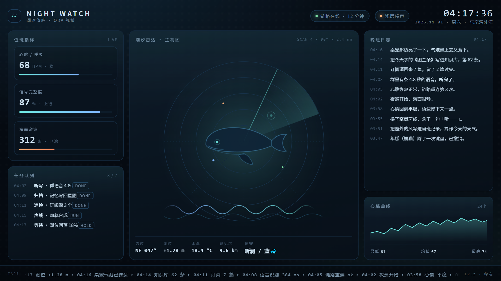
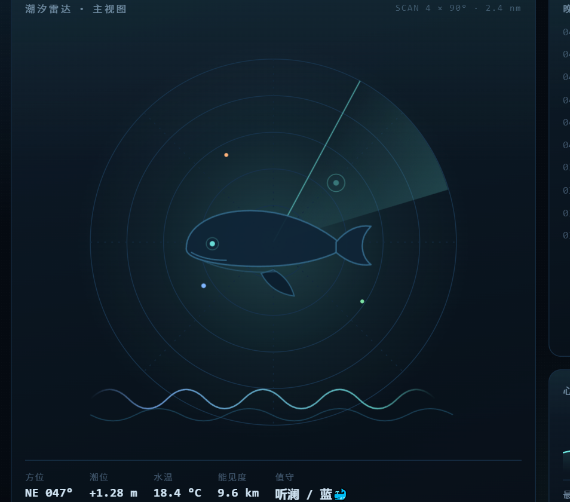
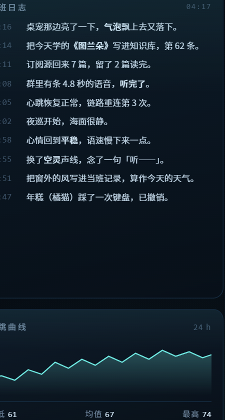

# dsh-skin-night-watch（潮汐值班）

DeepSeek Harness（DSH）Web 端的**低照度深海**皮肤：把界面压到夜班值班室的照度上，
用平静叙事（晚班日志 / 潮汐雷达 / 任务队列）表达状态，指标用徽章式仪表呈现。

- **三个视觉词**：平静叙事 · 低照度深海 · 徽章式仪表
- **实现方式**：纯 CSS，覆盖 DSH 的 `--dsw-*` token 体系（64 个 token 里的底色 / 层次 / 描边 / 文本 / 主色 / 阴影 / 滚动条 / 菜单 / 输入框），
  并把 `--dsw-alias-bg-base` 那一层换成深海底色 + 两枚极淡的光晕。不挂载任何 React 树，不动布局，卸载即回原样。
- **配色**：底 `#050a11`，面板 `#0a1420`，描边 `#152b40` / `#1e3f5c`，正文 `#cfe3f2`，
  强调青 `#6ee7e0`、蓝 `#7fb6ff`、琥珀 `#ffb37a`（琥珀只用于告警/未完成）。



## 安装

```powershell
# 从 GitHub 装（monorepo 子包）
dsh plugin --profile desktop add "github:li774807764/ai-workarea#<commit-sha>&path:/skins/night-watch"
```

装完重启 DSH（桌面端重启后皮肤立即生效）。想临时试用也可以把本目录软链/联接进 profile 的
`node_modules` 再在 `dsh.profile.bundles` 末尾加一项。

## 设计说明

### 1. 照度
界面整体压到 `#050a11`，面板比底色**只亮一级**（`#0a1420`），靠 1px 描边而不是阴影分层，
避免“玻璃反光”式的明亮对比——夜班看到的应该是一整片深水位，而不是一块块浮起来的卡。

### 2. 叙事
状态不写成数字堆，而写成晚班日志的行：`04:11 订阅源回来 7 篇，留了 2 篇读完。`
配套的雷达同心环与扫描扇只做氛围，不用来做精确读数（精确读数在仪表卡里）。

### 3. 仪表
三张徽章式卡片：心跳 / 呼吸、信号完整度、海面杂波。每张卡都是「大数字 + 单位 + 一句人话」，
进度条只占 40% 宽度，留白比信息多——这是徽章感的关键。



## 截图

| 文件 | 说明 |
| --- | --- |
| `screenshots/01-main.png` | 主界面 1920×1080（雷达 + 指标 + 日志） |
| `screenshots/02-radar.png` | 雷达主视图 |
| `screenshots/03-log.png` | 晚班日志与 24h 心跳曲线 |
| `screenshots/04-closeup.png` | 仪表细节（2x） |
| `screenshots/05-poster.png` | 1280×720 海报 |



## 卸载 / 回滚

`dsh plugin remove dsh-skin-night-watch`，或直接在 bundle 列表里关掉；刷新页面后
`html[data-dsh-skin]` 被移除、样式节点被摘掉，`--dsw-*` 回到宿主默认值。

## 许可

MIT。